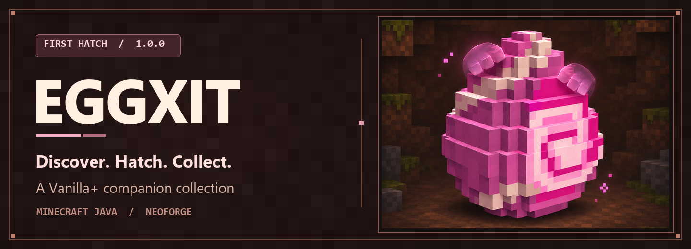
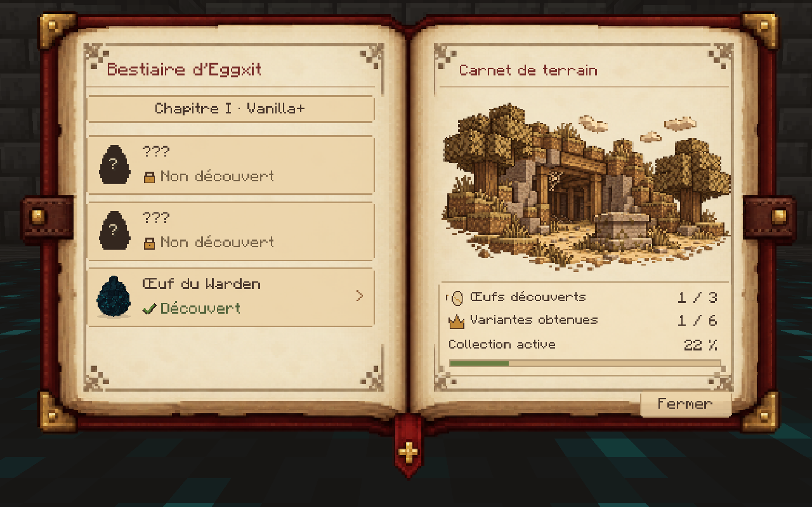
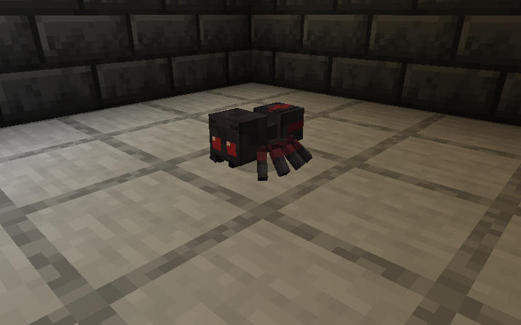
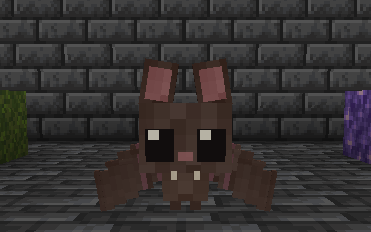
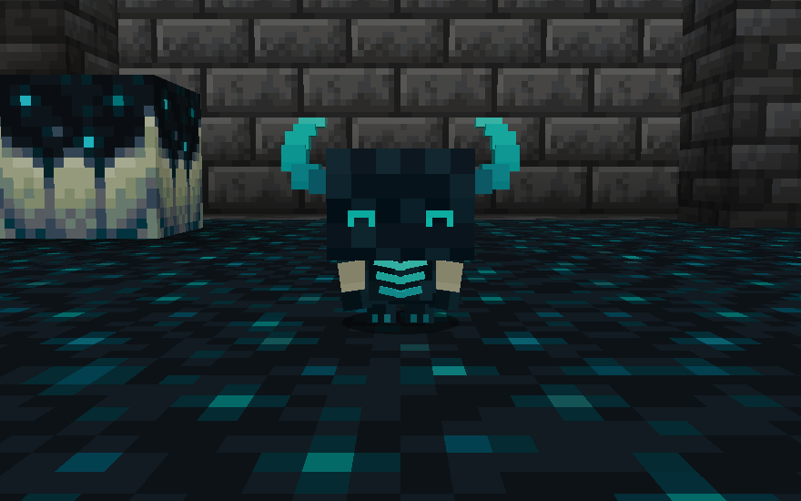
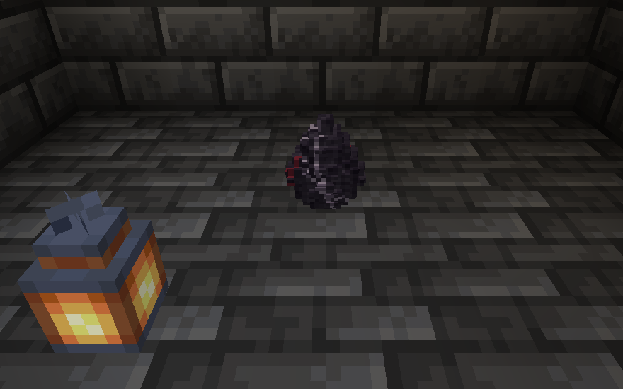
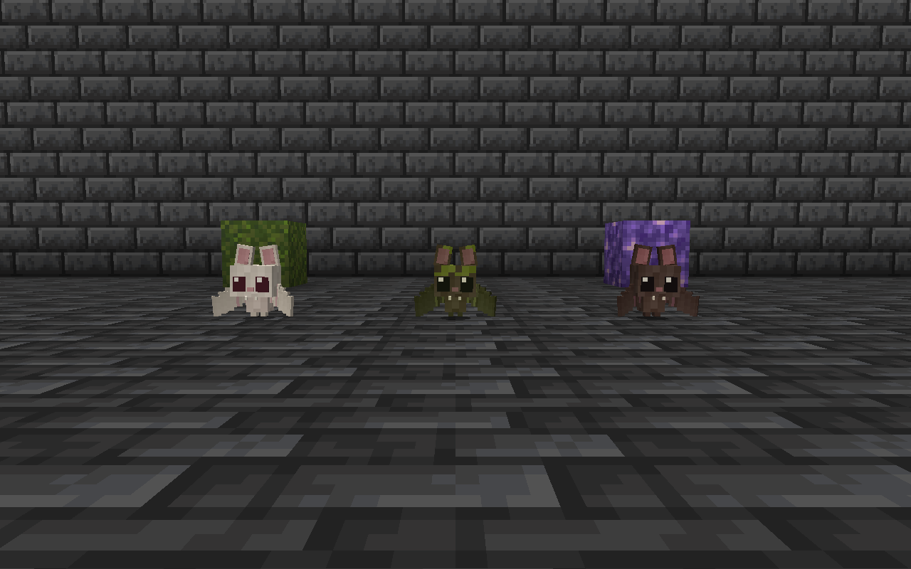

[Français](docs/README_FR.md)

# EGGXIT

**Discover. Hatch. Collect.**

*A charming Vanilla+ Minecraft creature collection adventure.*

**First Hatch 1.0.0** · Minecraft Java 1.21.1 · NeoForge 21.1.265 · Java 21 · GeckoLib 4.8 required

[Download](#download) · [Installation](docs/INSTALLATION.md) · [Bestiary](docs/BESTIARY.md) · [Gallery](docs/GALLERY.md)

## Welcome to Eggxit

Take the long way home. A forgotten mineshaft or a quiet cave might hold a small egg that’s easy to miss. Bring it back to your base, find out what helps it hatch and meet a new companion.

### Discover rare eggs

Eggs appear naturally as 3D blocks in suitable habitats. Look on the ground as you explore. Finding one is part of the journey, and the right incubation conditions vary by family.

### Complete your bestiary

Your illustrated field journal keeps track of the eggs you find and the companions you obtain. An unfamiliar silhouette becomes a portrait as you fill in your collection. Browse the illustrations, check your progress and read the notes in the margins for hints.

[How to use the bestiary](docs/BESTIARY.md)

### Meet miniature companions

- **Baby Spider** is a curious little companion. Its family also includes the rideable **Spider Mount**.
- **Baby Bat** takes flight, rests hanging from ceilings and comes in **Classic**, **Moss** and **Albino** variants.
- **Baby Warden** listens to nearby vibrations. Watch for the tilt of its head and the glow of its little horns.

[Meet the creatures and learn their interactions](docs/CREATURES.md)

## Screenshots

| Baby Spider | Baby Bat |
| --- | --- |
|  |  |
| **Baby Warden** | **Spider Egg** |
|  |  |

[Explore the full Minecraft gallery](docs/GALLERY.md)

## Installation

1. Open a Minecraft Java **1.21.1** instance with **NeoForge 21.1.265** and **Java 21**.
2. Install **GeckoLib 4.8 for NeoForge 1.21.1** and **Eggxit 1.0.0** in that instance’s `mods` folder.
3. Start Minecraft with the NeoForge profile.

[Full installation and troubleshooting guide](docs/INSTALLATION.md)

## Multiplayer

Install Eggxit and GeckoLib on the dedicated NeoForge server and on each player’s client. First Hatch was launched on a dedicated server and joined from a separate client. Bestiary progress is stored per player.

## Download

**CurseForge** is the intended download location for First Hatch. The official project link will appear here when it is confirmed.

[First Hatch changelog](CHANGELOG.md)

## Languages

Eggxit includes English and French translations. [Lire cette présentation en français](docs/README_FR.md)

## Support

Use the **Issues** tab on GitHub to report a bug or suggest an improvement. [How to file a useful report](CONTRIBUTING.md)

## Credits and license

Eggxit is made by the Eggxit project team. The mod uses NeoForge and GeckoLib. The logo and banner use an AI-assisted illustration. The gallery shows Minecraft screenshots. [NeoForge](https://neoforged.net/) · [GeckoLib](https://www.curseforge.com/minecraft/mc-mods/geckolib)

Eggxit’s code and original assets are **all rights reserved**. This repository hosts player documentation and media. [Rights and attributions](RIGHTS.md)
