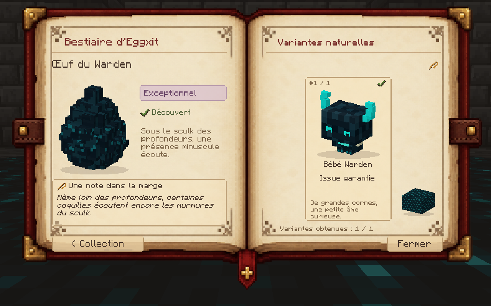

# The Eggxit Bestiary · Le bestiaire d’Eggxit

[Home](../README.md) · [Accueil](README_FR.md) · [Français](#français)

## English

1. Your world grants you an **Eggxit Bestiary** on your first join. To read it, hold the book and use it.
2. Pick up a wild egg to record the family. Open its entry from the collection page to read habitat and incubation clues. The back button returns to the index.
3. Hatch eggs and obtain companions to fill in variant portraits. Egg and variant counters track your own discoveries. Before discovery, some entries appear as silhouettes.
4. The book in your inventory is kept through death. You can store it in a chest and craft another if you need one.

Craft a spare with **one book, one feather and one obsidian** in any arrangement on a crafting table. Every copy shows the progress of the player reading it. The progress belongs to your player data in that world and survives death and reconnecting.

## Français

1. Le monde vous remet un **Bestiaire Eggxit** à votre première connexion. Prenez le livre en main et utilisez-le pour l’ouvrir.
2. Ramassez un œuf pour enregistrer sa famille. Depuis la page Collection, ouvrez sa fiche pour lire les indices d’habitat et d’incubation. Le bouton de retour vous ramène au sommaire.
3. Faites éclore vos œufs et obtenez des compagnons pour compléter les portraits de variantes. Les compteurs suivent vos découvertes personnelles. Certaines entrées apparaissent en silhouette tant qu’elles restent à découvrir.
4. Les exemplaires dans votre inventaire sont conservés à la mort. Vous pouvez ranger le livre dans un coffre ou en fabriquer un autre au besoin.

Pour fabriquer un exemplaire, placez **un livre, une plume et un bloc d’obsidienne** dans une table de craft, dans n’importe quel ordre. Chaque exemplaire affiche les découvertes de la personne qui l’ouvre. La progression est enregistrée avec les données de votre joueur dans le monde et reste disponible après une mort ou une reconnexion.

[More bestiary screenshots · Autres captures du bestiaire](GALLERY.md#illustrated-bestiary)
