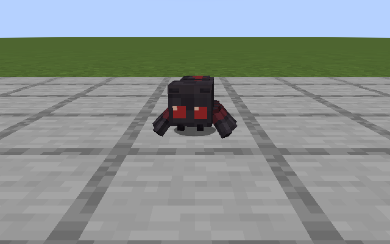
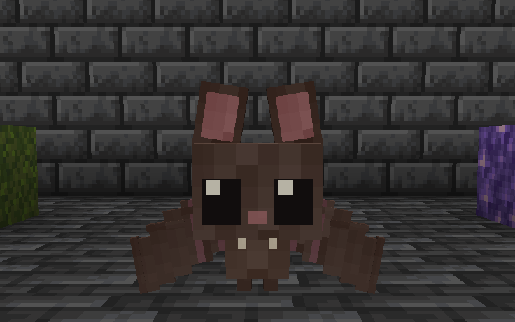
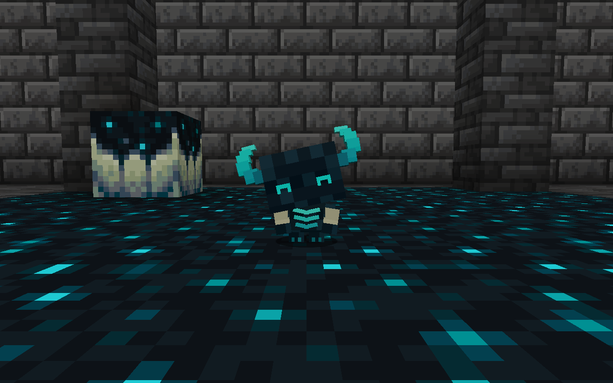

# Meet the companions · Les compagnons

[Home](../README.md) · [Accueil](README_FR.md) · [Français](#français)

## English

### Baby Spider and Spider Mount

The Baby Spider is a small, curious companion. Tame it with string, then use an empty main hand to switch between following and staying. The same family includes the Spider Mount. Its owner can equip a saddle and mount it with an empty hand where there is enough room.

### Baby Bat

A flying companion in **Classic**, **Moss** or **Albino**. It can hang under a ceiling to rest or perch on its owner’s shoulder when conditions allow. Use glow berries to tame it. An empty main hand toggles following and staying once it is tamed.

### Baby Warden

This little companion reacts to nearby vibrations. Offer a sculk block to tame it. Once it is yours, use an empty main hand to switch between following and staying.

## Français

- **Mini-araignée et araignée de selle.** Apprivoisez la mini-araignée avec de la ficelle, puis utilisez la main principale vide pour lui dire de vous suivre ou de rester. L’araignée de selle appartient à la même famille. Son propriétaire peut l’équiper d’une selle et la monter à main vide s’il dispose d’assez d’espace.
- **Mini-chauve-souris.** Elle existe en variantes **Classique**, **Mousse** et **Albinos**. Elle peut dormir sous un plafond ou se poser sur l’épaule de son propriétaire quand les conditions le permettent. Apprivoisez-la avec des baies lumineuses, puis utilisez la main principale vide pour alterner entre suivre et rester.
- **Bébé Warden.** Il prête attention aux vibrations proches. Apprivoisez-le avec un bloc de sculk. Une fois apprivoisé, un clic avec la main principale vide lui indique de suivre ou de rester.

[More in-game views · Autres vues en jeu](GALLERY.md)
