# Eggxit gallery

[Home](../README.md) · [Accueil en français](README_FR.md)

These are Minecraft screenshots from showcase and validation worlds. Some frames are cropped to make the subject easier to see.

- [Illustrated bestiary](#illustrated-bestiary) · [Spiders](#baby-spider-and-spider-mount) · [Bats](#baby-bat) · [Warden](#baby-warden) · [Eggs](#eggs-and-incubation) · [Collections](#companion-collections)

## Illustrated bestiary

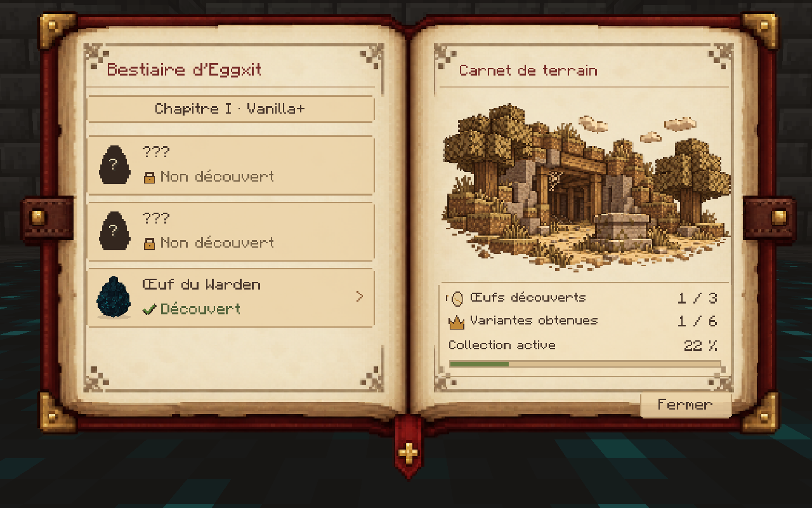

An open bestiary with its field illustration and collection progress.

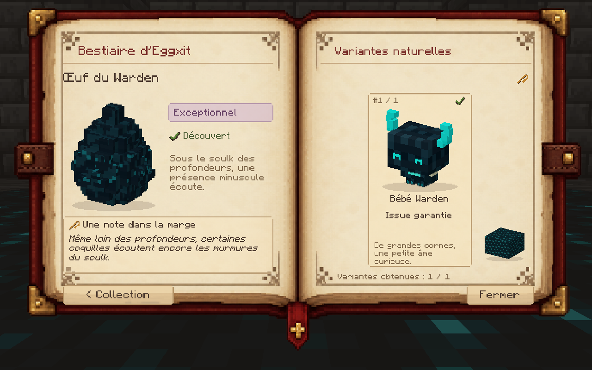

The Warden Egg entry and its discovered Baby Warden.

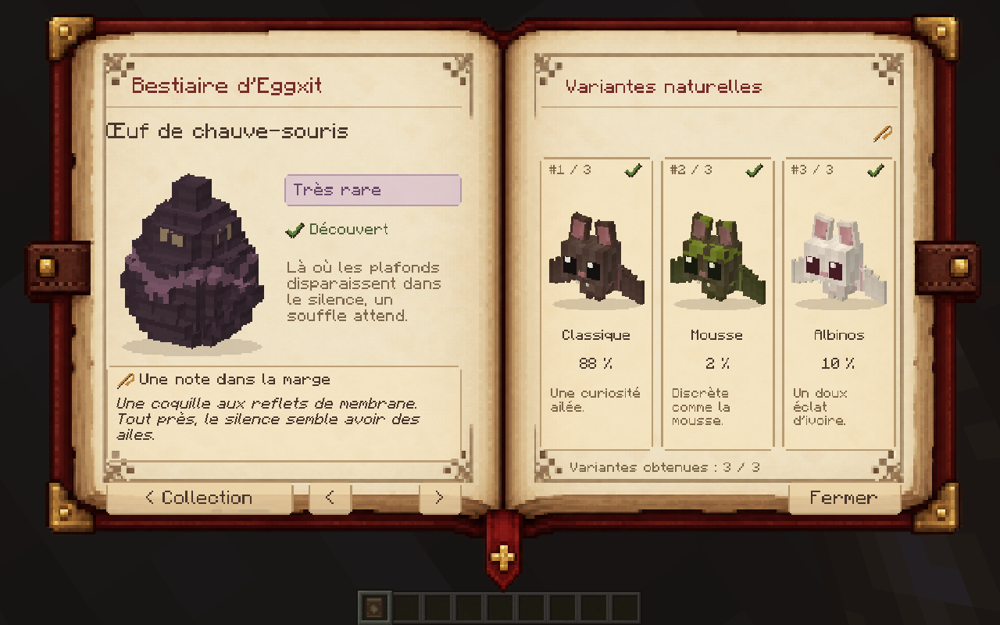

The Bat Egg entry with portraits of three discovered variants.

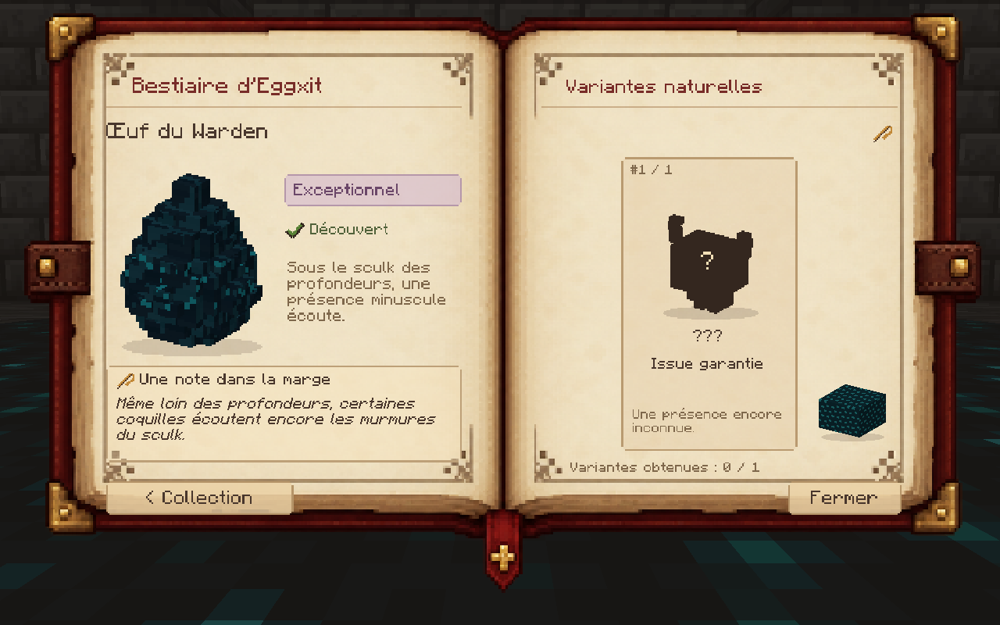

A bestiary entry with the hatchling still shown as a silhouette.

## Baby Spider and Spider Mount

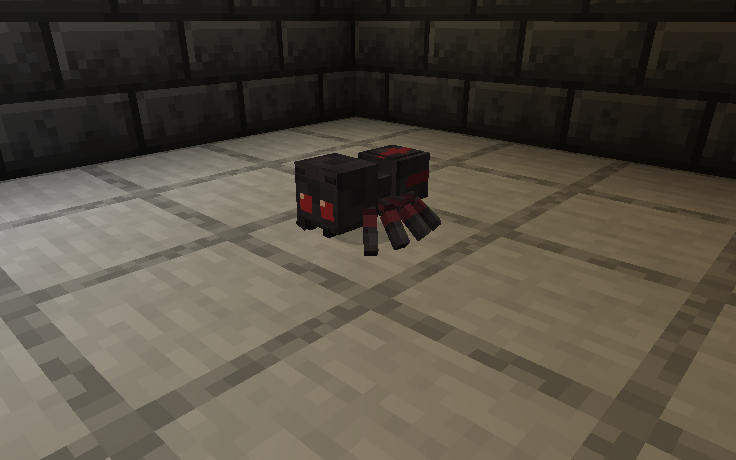

A Baby Spider on stone in a lantern-lit room.

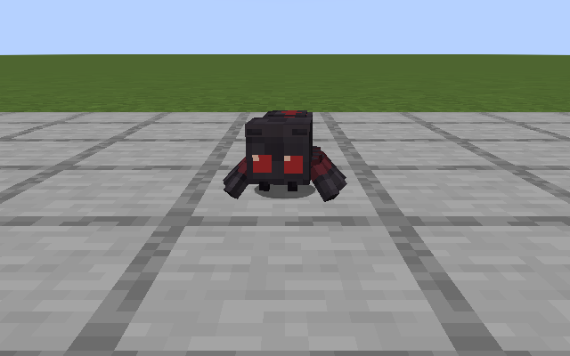

A curious Baby Spider facing the player.

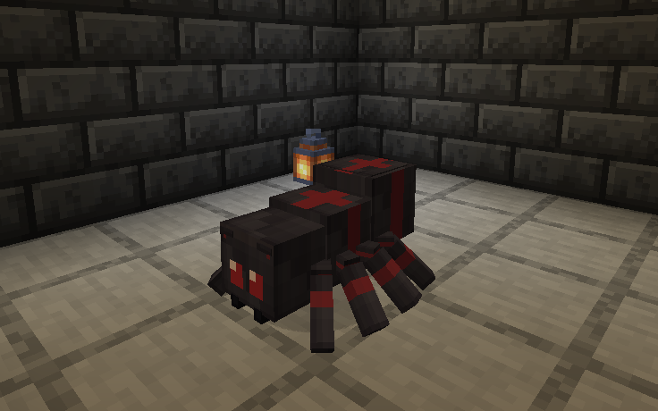

A Spider Mount near a lantern.

## Baby Bat

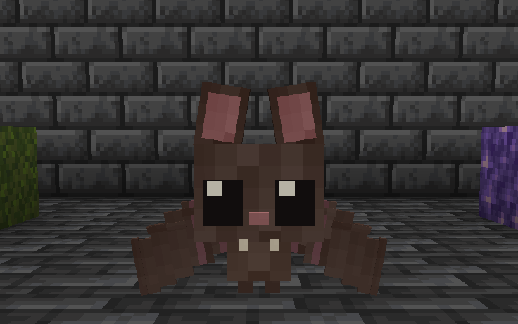

A Baby Bat flying low over a stone floor.

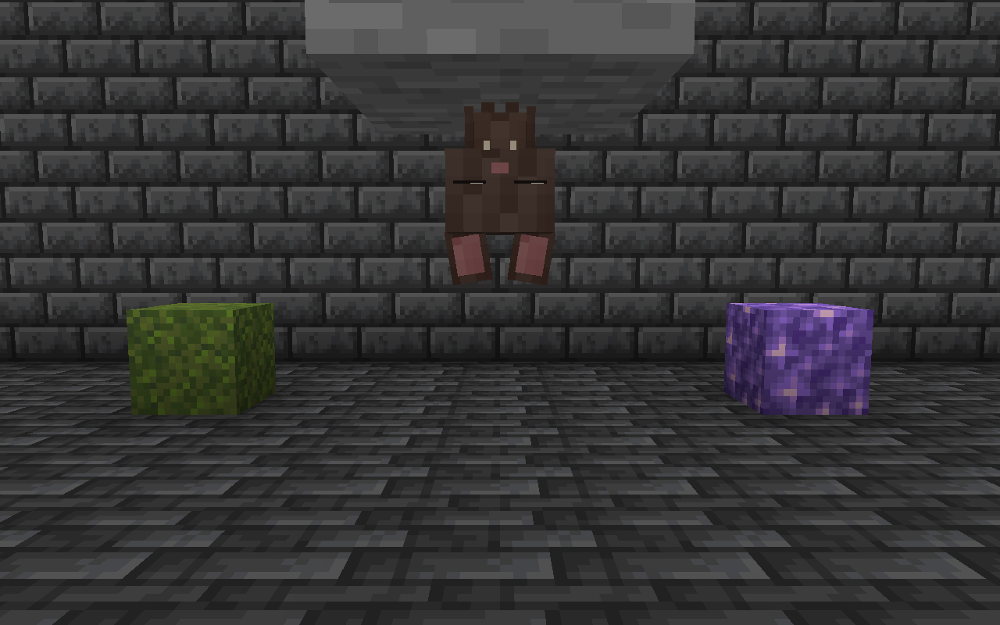

A Baby Bat hanging beneath a stone ledge.

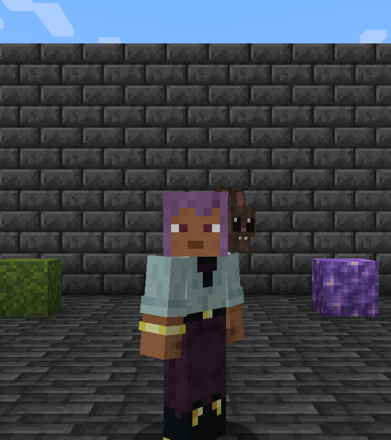

A Baby Bat perched on a player’s shoulder.

## Baby Warden

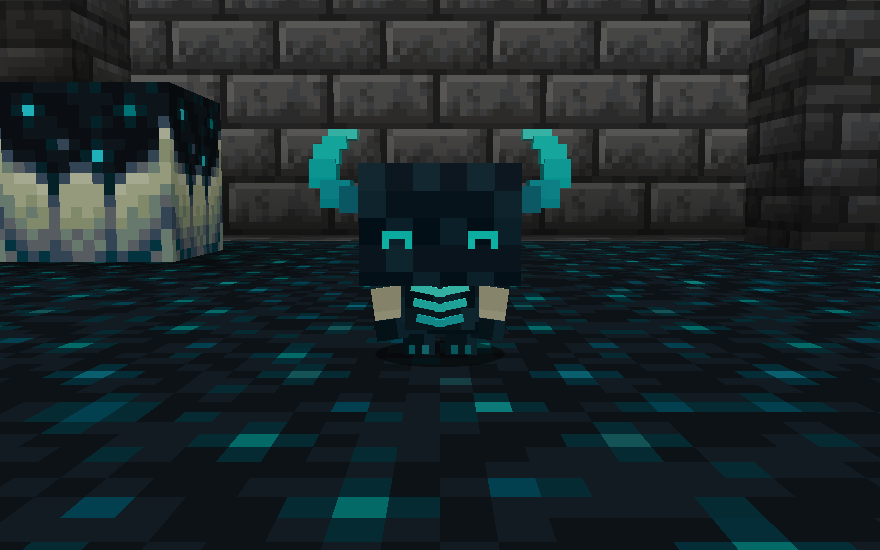

A Baby Warden seen from the front on sculk.

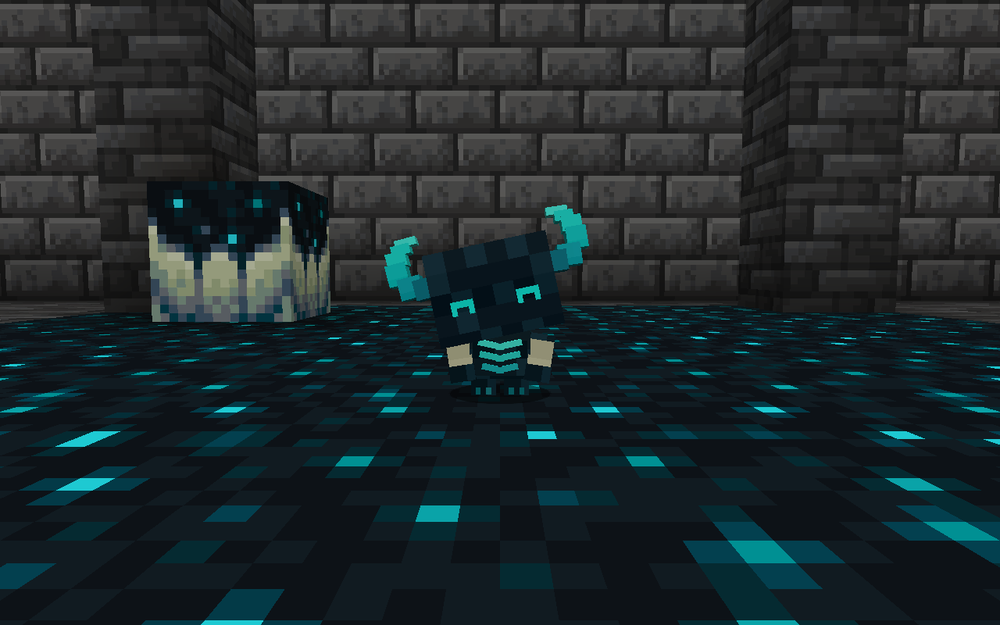

A Baby Warden tilting its head beside a sculk block.

## Eggs and incubation

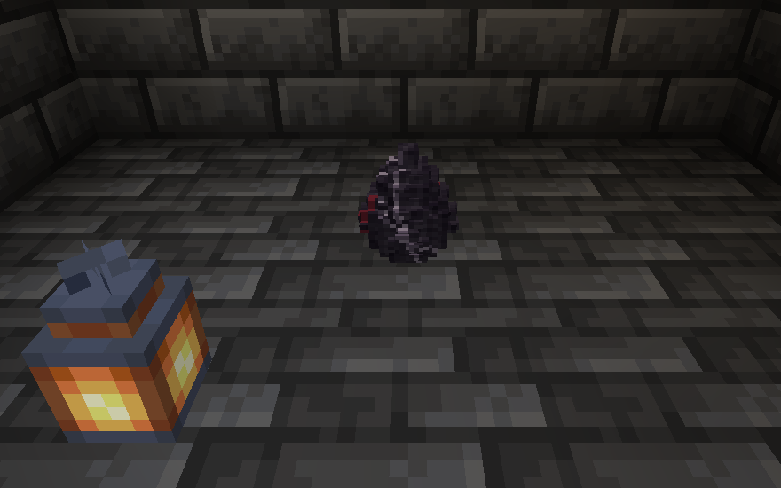

A Spider Egg placed on stone beside a lantern in a showcase scene.

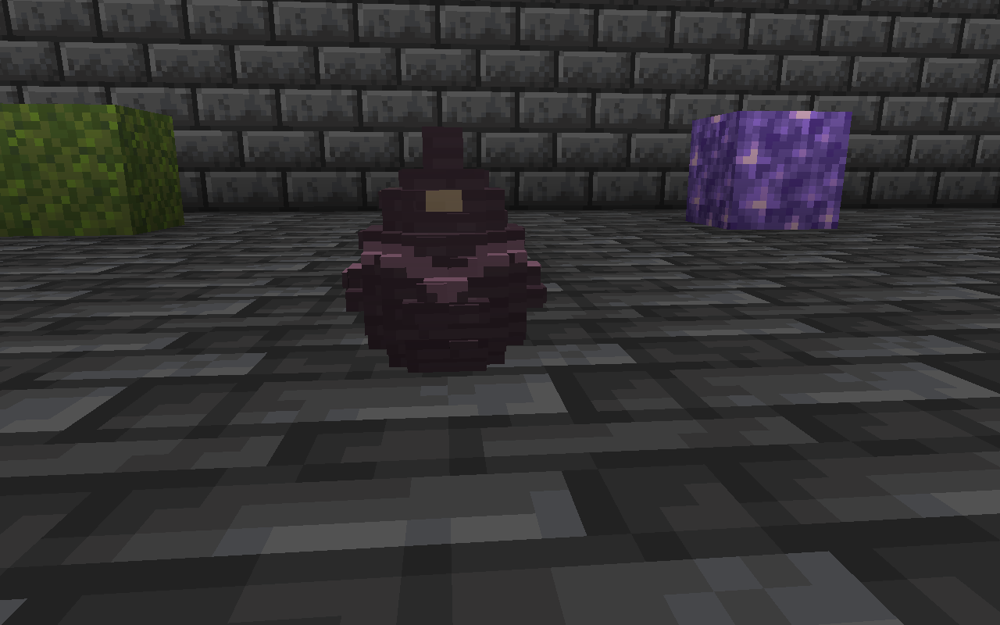

A Bat Egg on a stone floor beside moss and amethyst.

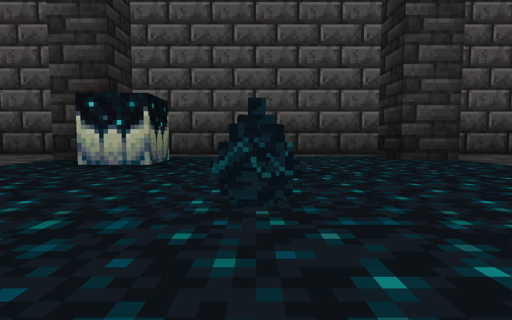

A Warden Egg incubating on sculk.

## Companion collections

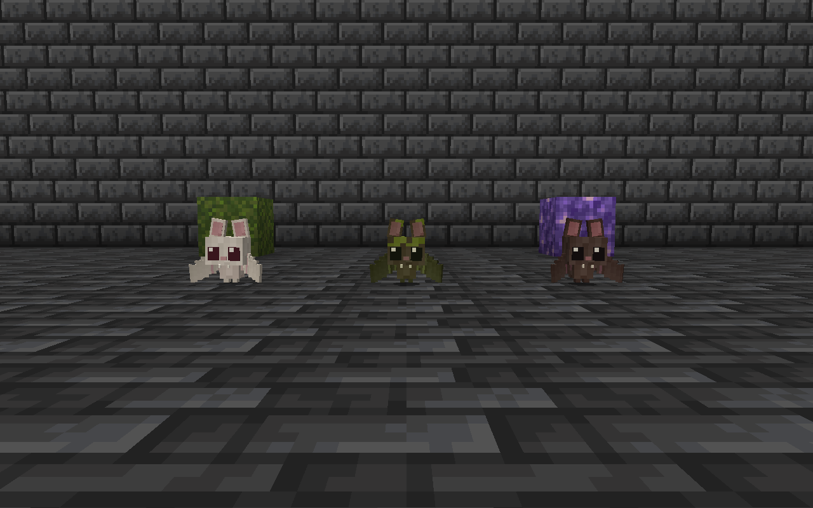

Three Baby Bat variants side by side, in ivory, moss green and brown.

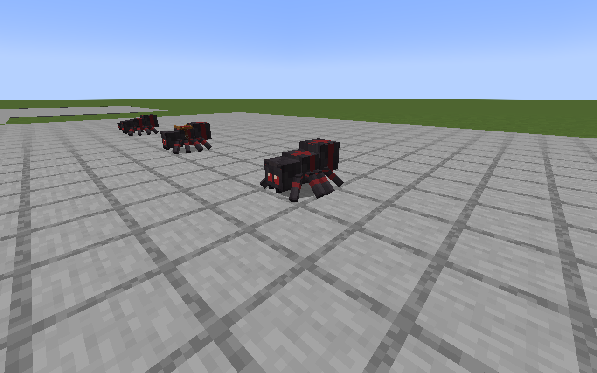

Several spider companions crossing a stone courtyard.
