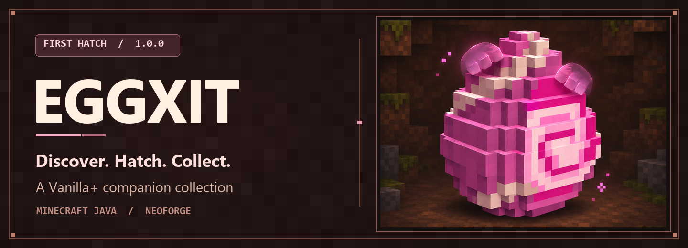
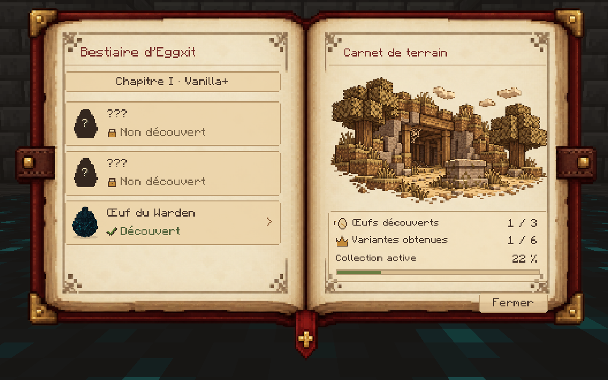
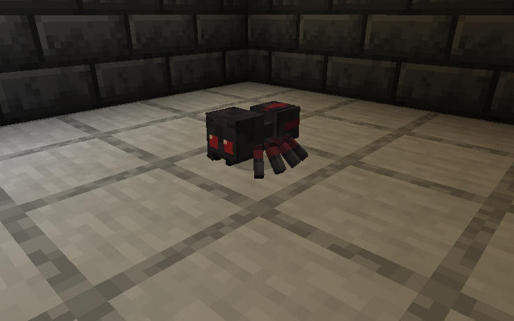
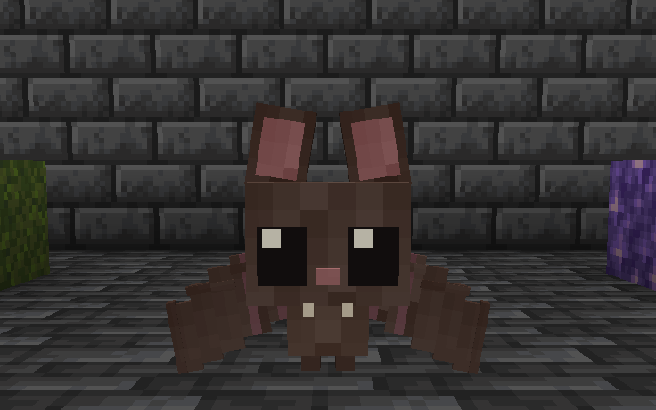
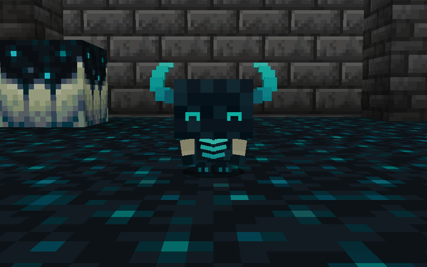
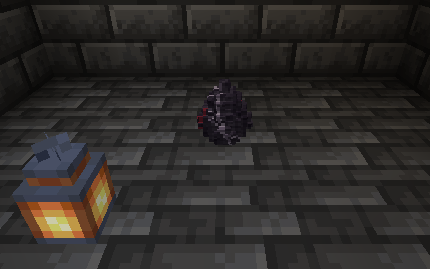
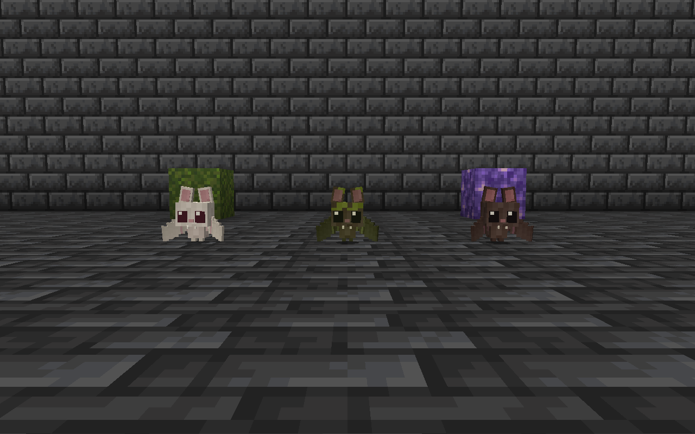

[English](../README.md)

# EGGXIT

**Explorez. Faites éclore. Collectionnez.**

*Une aventure de collection de petits compagnons dans l’esprit Vanilla+.*

**First Hatch 1.0.0** · Minecraft Java 1.21.1 · NeoForge 21.1.265 · Java 21 · GeckoLib 4.8 requis

[Téléchargement](#téléchargement) · [Installation](INSTALLATION.md#français) · [Bestiaire](BESTIARY.md#français) · [Galerie](GALLERY.md)

## Bienvenue dans Eggxit

Au détour d’une galerie oubliée ou d’une grotte silencieuse, une petite coquille peut passer inaperçue. Rapportez votre trouvaille à la base, cherchez ce qui l’aidera à éclore et faites connaissance avec votre nouveau compagnon.

### Cherchez des œufs rares

Les œufs apparaissent naturellement sous forme de blocs en 3D dans les habitats adaptés à leur espèce. Regardez au sol pendant vos explorations. Une fois l’œuf trouvé, les conditions d’incubation varient d’une famille à l’autre.

### Remplissez votre bestiaire

Ce carnet illustré garde la trace de vos œufs et des compagnons obtenus. Au fil des découvertes, les silhouettes laissent place à des portraits. Feuilletez les fiches et lisez les notes en marge pour trouver des indices et suivre votre collection.

[Apprendre à utiliser le bestiaire](BESTIARY.md#français)

### Rencontrez les compagnons

- **La mini-araignée** est curieuse et vive. Sa famille compte aussi l’**araignée de selle**, que vous pouvez monter.
- **La mini-chauve-souris** vole, se repose la tête en bas et se décline en trois variantes, **Classique**, **Mousse** et **Albinos**.
- **Le bébé Warden** écoute les vibrations proches. Observez le mouvement de sa tête et l’éclat de ses petites cornes.

[Les familles et leurs interactions](CREATURES.md#français)

## Captures

| Mini-araignée | Mini-chauve-souris |
| --- | --- |
|  |  |
| **Bébé Warden** | **Œuf d’araignée** |
|  |  |

[Voir la galerie Minecraft complète](GALLERY.md)

## Installation

1. Préparez une instance Minecraft Java **1.21.1** avec **NeoForge 21.1.265** et **Java 21**.
2. Installez **GeckoLib 4.8 pour NeoForge 1.21.1** et **Eggxit 1.0.0** dans le dossier `mods` de l’instance.
3. Lancez le profil NeoForge.

[Guide d’installation et dépannage](INSTALLATION.md#français)

## Multijoueur

Installez Eggxit et GeckoLib sur le serveur dédié NeoForge et chez chaque joueur. First Hatch a été lancé sur un serveur dédié avec une connexion depuis un client séparé. Chaque joueur conserve sa propre progression de bestiaire.

## Téléchargement

**CurseForge** est la plateforme de téléchargement prévue pour First Hatch. Le lien officiel sera ajouté à cette page après confirmation.

[Journal de First Hatch](../CHANGELOG.md)

## Langues

Eggxit est disponible en français et en anglais. [English presentation](../README.md)

## Assistance

L’onglet **Issues** du dépôt GitHub accueille les signalements et suggestions. [Préparer un signalement](../CONTRIBUTING.md#français)

## Crédits et droits

Eggxit est réalisé par l’équipe du projet. Le mod s’appuie sur NeoForge et GeckoLib. Le logo et la bannière reprennent une illustration réalisée avec l’aide de l’IA. La galerie présente des captures Minecraft. [NeoForge](https://neoforged.net/) · [GeckoLib](https://www.curseforge.com/minecraft/mc-mods/geckolib)

Le code et les ressources originales d’Eggxit sont **tous droits réservés**. Ce dépôt réunit la documentation et les médias destinés aux joueurs. [Droits et attributions](../RIGHTS.md#français)
